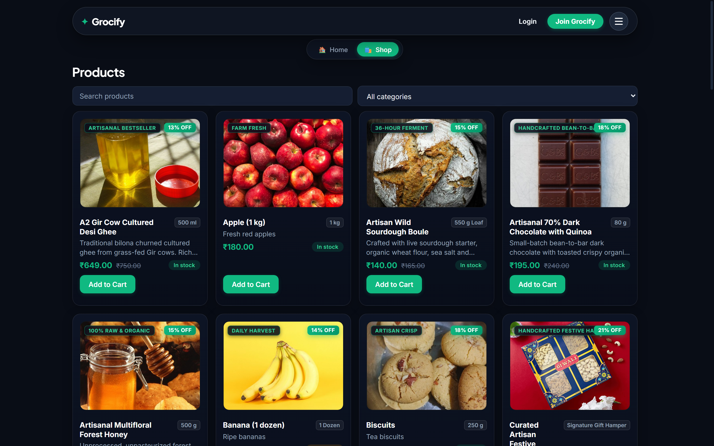
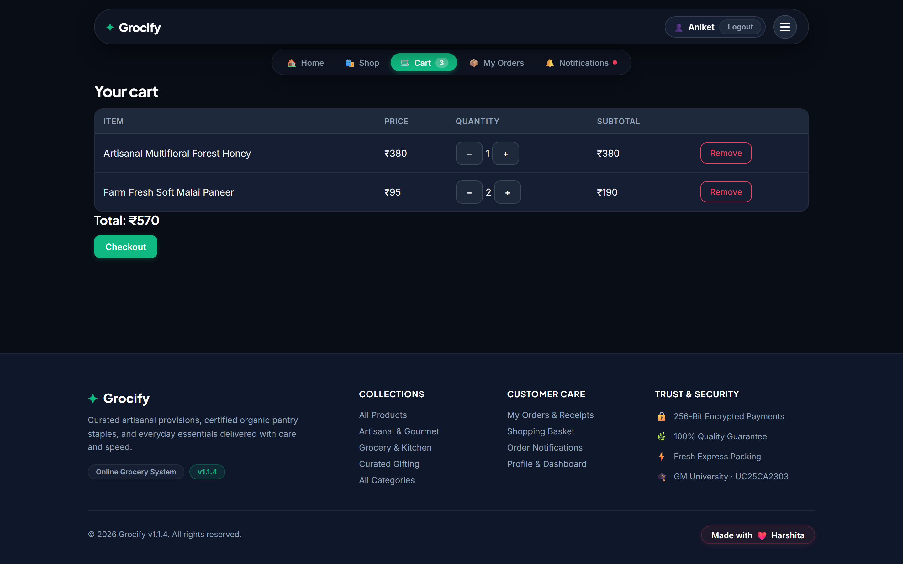
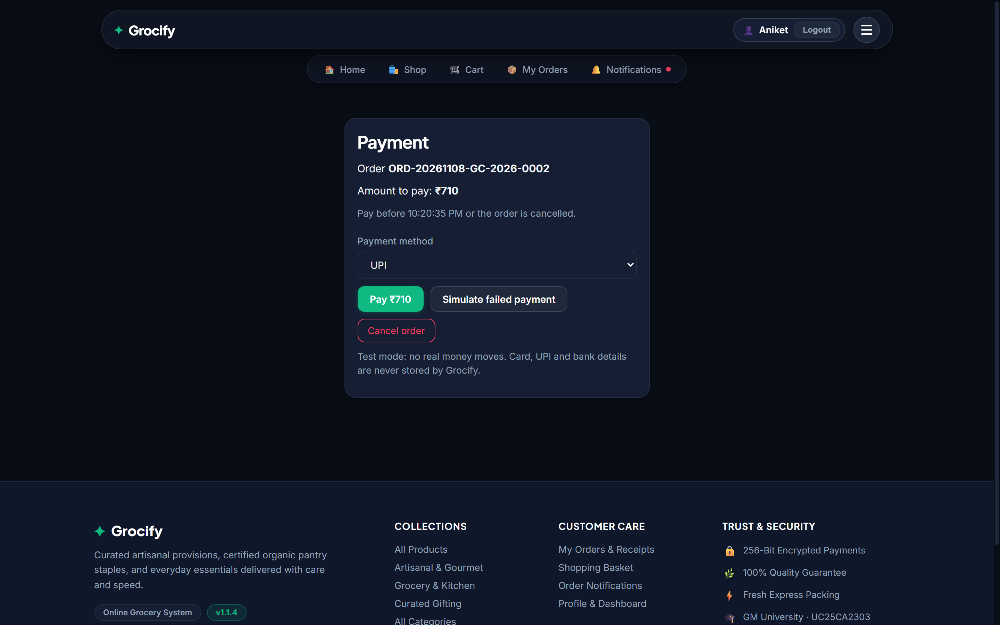
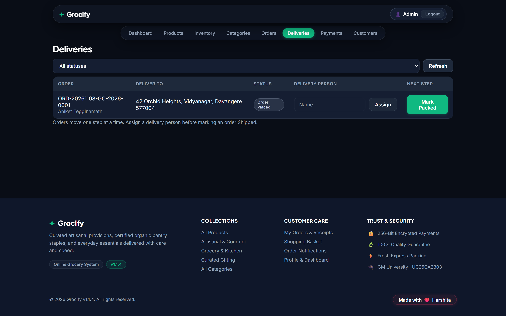
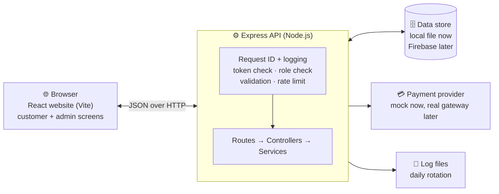
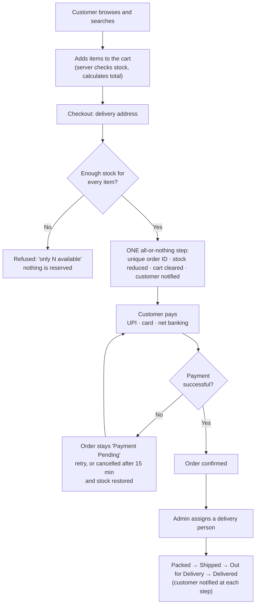
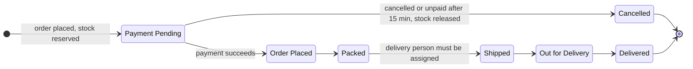
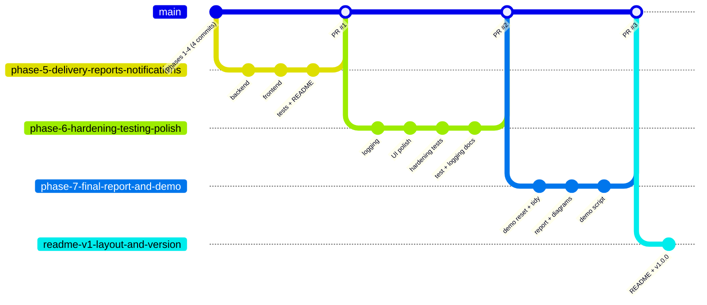

<div align="center">

# 🛒 Grocify

### Online Grocery E-Commerce System with Secure Digital Payments and Logistics Management

Browse, cart, order, pay and track groceries online, with a full admin console behind it.

[](#-versioning)
[](#-testing)
[](https://nodejs.org)
[](https://react.dev)
[](https://expressjs.com)
[](https://vite.dev)
[](#-tech-stack)
[](#-known-limitations)

[Features](#-features) · [Screenshots](#-screenshots) · [Tech stack](#-tech-stack) · [Quick start](#-quick-start) · [Project structure](#-project-structure) · [Workflow](#-workflow) · [API](#-api-reference) · [Testing](#-testing) · [Docs](#-documentation)

</div>

---

## 📑 Table of contents

- [About](#-about)
- [Features](#-features)
- [Screenshots](#-screenshots)
- [Tech stack](#-tech-stack)
- [Architecture](#-architecture)
- [Quick start](#-quick-start)
- [Configuration](#-configuration)
- [Scripts](#-scripts)
- [Project structure](#-project-structure)
- [Workflow](#-workflow)
- [API reference](#-api-reference)
- [Roles and permissions](#-roles-and-permissions)
- [Security](#-security)
- [Logging](#-logging)
- [Testing](#-testing)
- [Known limitations](#-known-limitations)
- [Roadmap](#-roadmap)
- [Documentation](#-documentation)
- [Versioning](#-versioning)
- [License](#-license)

---

## 🌱 About

Grocify is a working online grocery store built as a college **Project Based Learning (PBL)** assignment for the course *E-Commerce and Digital Business* (UC25CA2303, GM University).

Customers can search groceries, fill a cart, place an order, pay digitally (UPI, card or net banking) and follow the order until it is delivered. Administrators manage products, categories, customers, orders, payments, stock and deliveries from one place, and read sales reports.

Beyond the basic shopping flow, the design focuses on what makes real shops fail: two customers buying the last item at the same moment, a double-clicked pay button, stock held by orders nobody pays for, and card details ending up in the wrong place.

> **Status:** all ten required functions work and are covered by automated tests. The prototype uses a local data store and a **mock payment gateway** (no real money moves). See [Known limitations](#-known-limitations).

## ✨ Features

<table>
<tr>
<td width="50%" valign="top">

### 👤 Customer
- Register, log in, edit profile and delivery address
- Browse by category, search, see price / description / availability
- Cart: add, change quantity, remove, automatic total
- Place an order with a delivery address and a unique order ID
- Pay by **UPI, card or net banking**, with retry on failure
- Order history and a **delivery timeline**
- In-app **notifications** for order, payment and delivery updates

</td>
<td width="50%" valign="top">

### 🛠️ Admin
- Dashboard with revenue, orders and low-stock counts
- Add, edit and delete products and categories
- View and manage orders, customers and payments
- **Inventory** view with low-stock highlighting
- **Assign delivery** and move orders through five delivery steps
- **Sales and order reports** with a date range

</td>
</tr>
<tr>
<td colspan="2">

### ⚙️ Built-in dependability
- **All-or-nothing order creation:** stock check, stock reduction, order write and cart clear happen as one step
- **Unique order IDs** per customer (`ORD-20261107-AB12-0001`), safe under concurrent orders
- **Double-click safe checkout** using a one-time idempotency key
- **Automatic stock release** when an order is unpaid after 15 minutes or cancelled
- **No card or UPI details ever stored**; payment goes through a swappable provider layer
- **Request-ID logging** with daily rotating files

</td>
</tr>
</table>

## 📸 Screenshots

<table>
<tr>
<td align="center"><br><sub><b>Storefront:</b> curated hero & collection navigation</sub></td>
<td align="center"><br><sub><b>Products:</b> category filter, search, badges & Indian grocery photography</sub></td>
</tr>
<tr>
<td align="center"><br><sub><b>Cart:</b> quantity controls, instant subtotals and checkout</sub></td>
<td align="center"><br><sub><b>Payment:</b> UPI, card or net banking with retry logic</sub></td>
</tr>
<tr>
<td align="center"><br><sub><b>Tracking:</b> real-time five-step delivery timeline</sub></td>
<td align="center"><br><sub><b>Inventory Operations:</b> SKU monitoring & instant restock</sub></td>
</tr>
<tr>
<td align="center"><br><sub><b>Logistics:</b> order assignment and step advancement</sub></td>
<td align="center"><br><sub><b>Analytics:</b> revenue, order breakdown & top-selling items</sub></td>
</tr>
</table>

More screens (confirmation, dashboard, inventory management) are in [`docs/screenshots`](docs/screenshots). A clickable design mock-up is in [`docs/mockup.html`](docs/mockup.html).

## 🧰 Tech stack

### Languages

| Language | Where it is used | Approx. size |
|---|---|---|
| **JavaScript** (ES modules, Node.js) | Backend: server, data store, payments, middleware, scripts | ~1,200 lines in 38 files |
| **JavaScript + JSX** (React) | Frontend: screens, components, state | ~1,300 lines in 37 files |
| **CSS3** | Frontend styling (hand-written, no framework) | ~40 lines |
| **HTML5** | App shell (`index.html`) and the design mock-up | ~200 lines |
| **JavaScript** | Automated tests (`node:test`) | ~725 lines in 4 files |
| **Python 3** | Documentation tooling only: draws diagrams, builds the Word report | ~600 lines |
| **Markdown** | Documentation | this file and `docs/` |

### Frontend

| Technology | Version | Purpose |
|---|---|---|
| [React](https://react.dev) | 19.3.1 | User interface |
| [React Router](https://reactrouter.com) | 7.18.5 | Pages and navigation |
| [Vite](https://vite.dev) | 8.3.6 | Dev server and build |
| [@vitejs/plugin-react](https://github.com/vitejs/vite-plugin-react) | 6.2.1 | React support for Vite |
| JavaScript, JSX, CSS3, HTML5 | n/a | Languages (no TypeScript, no CSS framework) |

### Backend

| Technology | Version | Purpose |
|---|---|---|
| [Node.js](https://nodejs.org) | ≥ 22.12 (developed on 24.14) | Runtime |
| [Express](https://expressjs.com) | 5.3.0 | Web framework and routing |
| [bcryptjs](https://github.com/dcodeIO/bcrypt.js) | 3.0.3 | Password hashing |
| [jsonwebtoken](https://github.com/auth0/node-jsonwebtoken) | 9.0.3 | Signed login tokens |
| [helmet](https://helmetjs.github.io) | 8.3.0 | Security headers |
| [cors](https://github.com/expressjs/cors) | 2.8.6 | Allowed website address |
| [express-rate-limit](https://github.com/express-rate-limit/express-rate-limit) | 8.7.3 | Login attempt limiting |
| [dotenv](https://github.com/motdotla/dotenv) | 18.0.9 | Settings from `.env` |
| [Winston](https://github.com/winstonjs/winston) | 3.19.0 | Logging |
| [winston-daily-rotate-file](https://github.com/winstonjs/winston-daily-rotate-file) | 5.0.0 | Daily rotating log files |

### Data, payments and tooling

| Area | Today | Planned |
|---|---|---|
| **Data store** | Local JSON file (`server/data/localStore.js`) | Firebase Firestore (same function names) |
| **Login** | bcrypt + signed tokens (HS256, 7 days) | Firebase Authentication |
| **Payments** | Mock provider (`server/payments/mockProvider.js`) | Real gateway through the same interface |
| **Testing** | Node's built-in test runner (`node:test`) | n/a |
| **Docs tooling** | Python 3 with `python-docx` and `matplotlib` | n/a |
| **Version control** | Git and GitHub, pull-request workflow | n/a |

## 🏗️ Architecture

The website never touches data directly. Every action goes through the server, which checks **who** is asking (token), **what they may do** (role) and **whether the input is valid** before reading or changing anything.



Design diagrams (ER diagram, order flow) are in the [project report](docs/Grocify-Project-Report.docx) and [`docs/diagrams`](docs/diagrams).

## 🚀 Quick start

### Prerequisites

- **Node.js 22.12 or newer** (check with `node -v`) and **npm**
- **Git**

### Run it

```bash
# 1. Get the code
git clone https://github.com/Aniket886/Grocify.git
cd Grocify

# 2. Install dependencies
npm install

# 3. Create your settings file, then open .env and set SEED_ADMIN_EMAIL and SEED_ADMIN_PASSWORD
cp .env.example .env

# 4. Create sample products and the admin account
npm run seed

# 5. Start the server (terminal 1)
npm run server

# 6. Start the website (terminal 2)
npm run dev:client
```

Then open **http://localhost:5173**. The API runs on port 5000.

> On Windows, use Git Bash or PowerShell; the commands are the same (use `Copy-Item .env.example .env` instead of `cp` in PowerShell).

**Log in as admin** with the email and password you put in `.env`. **Customers** register from the website. No real money is used: the payment page runs in test mode with a "Simulate failed payment" button.

**Start clean before a demo:** `npm run demo:reset` wipes all data and recreates the samples.

## 🔧 Configuration

Copy `.env.example` to `.env`. `.env` is git-ignored and must never be committed.

| Variable | Default | Purpose |
|---|---|---|
| `NODE_ENV` | `development` | `production` switches off test-only payment shortcuts |
| `PORT` | `5000` | API port |
| `CLIENT_URL` | `http://localhost:5173` | Website address allowed to call the API |
| `JWT_SECRET` | random per start | Signs login tokens. **Set a long random value**, or logins reset on every restart |
| `JWT_EXPIRES_IN` | `7d` | Login lifetime |
| `SEED_ADMIN_EMAIL` / `SEED_ADMIN_PASSWORD` | none | Admin account created by `npm run seed` |
| `PAYMENT_PROVIDER` | `mock` | Payment provider (`mock` or `gateway`) |
| `PAYMENT_TIMEOUT_MINUTES` | `15` | Unpaid orders are cancelled after this, and stock is released |
| `LOW_STOCK_DEFAULT_LIMIT` | `10` | Low-stock limit for new products |
| `LOG_LEVEL` / `LOG_DIR` | `info` / `./logs` | Logging level and folder |
| `LOG_MAX_FILES` / `LOG_MAX_SIZE` | `14d` / `10m` | Log rotation |
| `DATA_FILE` | `server/data/dev-db.json` | Where the local data file lives (optional). Not tracked by Git |
| `DATABASE_URL` | (empty) | Postgres connection string. When set, all users, addresses, orders and payments are stored there and survive every redeploy |
| `FIREBASE_*`, `VITE_FIREBASE_*`, `VITE_GOOGLE_CREATOR_ID` | none | **Not used yet.** Reserved for the Firebase step |
| `PAYMENT_GATEWAY_*`, `PAYMENT_WEBHOOK_SECRET` | none | **Not used yet.** Reserved for a real gateway |

## 📜 Scripts

| Command | What it does |
|---|---|
| `npm run server` | Start the API (port 5000) |
| `npm run dev:server` | Start the API and restart on file changes |
| `npm run dev:client` | Start the website (port 5173, proxies `/api` to the server) |
| `npm run build` | Build the website into `dist/` |
| `npm run seed` | Create sample products and the admin account |
| `npm run demo:reset` | Wipe all local data, then seed again (refuses in production) |
| `npm test` | Run all 45 automated tests |

## 🗂️ Project structure

```text
Grocify/
├── index.html                  # App shell loaded by Vite
├── vite.config.js              # Vite setup: React plugin, /api proxy, app version
├── package.json                # Scripts, dependencies, and the app VERSION (single source)
├── .env.example                # Settings template (blank values); copy to .env
├── firebase.json               # Firebase config (placeholder until Firebase is connected)
├── firestore.rules             # Deny-all rules: only the server talks to the database
│
├── server/                     # ── BACKEND (Node.js + Express, JavaScript ES modules)
│   ├── index.js                #   Starts the API and the 1-minute expiry sweep
│   ├── app.js                  #   Builds the app: request ID, security, logging, routes
│   ├── seed.js                 #   Sample products + admin account
│   ├── resetDemo.js            #   Wipe data and re-seed (npm run demo:reset)
│   ├── config/
│   │   ├── env.js              #   Reads .env, app version, defaults
│   │   ├── logger.js           #   Winston: levels, JSON lines, daily rotation
│   │   └── firebaseAdmin.js    #   Placeholder for Firebase Admin (empty on purpose)
│   ├── middleware/
│   │   ├── authenticate.js     #   Verifies the login token
│   │   ├── authorize.js        #   Role check (customer / admin)
│   │   ├── validate.js         #   Input validators
│   │   ├── rateLimit.js        #   Login attempt limiter
│   │   └── errorHandler.js     #   404 and error responses (with request ID)
│   ├── routes/                 #   URL → controller maps (auth, products, categories, cart,
│   │                           #     orders, payments, inventory, notifications, admin)
│   ├── controllers/            #   Request handling and business rules (one per area)
│   ├── services/
│   │   └── orderService.js     #   Expires unpaid orders and logs each one
│   ├── payments/
│   │   ├── PaymentProvider.js  #   The interface every provider follows
│   │   ├── mockProvider.js     #   Fake gateway used now
│   │   ├── gatewayProvider.js  #   Empty slot for the real gateway
│   │   └── index.js            #   Picks the provider from PAYMENT_PROVIDER
│   ├── data/
│   │   └── localStore.js       #   Local data store + all-or-nothing order logic
│   └── utils/constants.js      #   Delivery steps and notification types
│
├── src/                        # ── FRONTEND (React + Vite, JavaScript/JSX + CSS)
│   ├── main.jsx                #   Entry point
│   ├── App.jsx                 #   Providers, navbar, routes, footer
│   ├── routes/                 #   AppRoutes, ProtectedRoute (login), AdminRoute (admin)
│   ├── context/                #   AuthContext (login state), CartContext (cart state)
│   ├── services/api.js         #   fetch wrapper that adds the login token
│   ├── components/             #   Navbar, Footer, ProductCard, StatusBadge,
│   │                           #     DeliveryTimeline, ErrorBoundary
│   ├── pages/
│   │   ├── customer/           #   14 screens: Home, Login, Register, Profile, ProductList,
│   │   │                       #     ProductDetail, Cart, Checkout, Payment, PaymentConfirmation,
│   │   │                       #     OrderHistory, OrderTracking, Notifications, NotFound
│   │   └── admin/              #   9 screens: Dashboard, ManageProducts, ManageCategories,
│   │                           #     ManageCustomers, ManageOrders, ManagePayments, Inventory,
│   │                           #     Deliveries, Reports
│   ├── styles/main.css         #   All styling
│   └── config/firebase.js      #   Placeholder for Firebase (empty on purpose)
│
├── tests/                      # ── 45 automated tests (node:test)
│   ├── api.test.js             #   Login, roles, products, cart
│   ├── orders.test.js          #   Orders, IDs, payment, inventory, concurrency
│   ├── delivery.test.js        #   Delivery steps, notifications, admin views, reports
│   └── hardening.test.js       #   Bad input, security, stress, logging safety, version
│
├── docs/                       # ── DOCUMENTATION
│   ├── Grocify-Project-Report.docx   # The PBL project report (Word)
│   ├── Demo-Script.md          #   Demo steps and viva preparation
│   ├── Test-Report.md          #   Every test, by requirement
│   ├── Logging.md              #   What is logged, with a real sample
│   ├── Phase2-Design.md        #   Use cases, ER diagram, flows, data model
│   ├── mockup.html             #   Clickable design mock-up
│   ├── diagrams/               #   Diagram images + make_diagrams.py
│   ├── screenshots/            #   App screenshots used in the report and this README
│   └── report/build_report.py  #   Rebuilds the Word report (Python)
│
├── logs/                       # Runtime logs (git-ignored)
└── public/images/              # Static images (placeholder)
```

<sub>Not tracked by Git: `node_modules/`, `dist/`, `.env`, `logs/*.log`, and `server/data/dev-db.json` (your local data).</sub>

## 🔄 Workflow

### 1. How an order moves through the system



### 2. Order status lifecycle



Delivery moves **one step at a time**: no skipping and no going back.

### 3. Development workflow

The project was built in seven phases that fit the 14-week PBL timeline. Each phase ended with something that could be run and checked.

| Phase | Work | Delivered through |
|---|---|---|
| 1 Plan | Problem, roles, tools, project set-up | First push to `main` |
| 2 Design | Use cases, data model, flows, clickable mock-up | First push to `main` |
| 3 Core shopping | Login, products, cart, admin product management | First push to `main` |
| 4 Orders and payment | Orders, mock payment, stock updates | First push to `main` |
| 5 Delivery and admin | Delivery tracking, notifications, reports | [PR #1](https://github.com/Aniket886/Grocify/pull/1) |
| 6 Hardening | Logging fixes, 13 hardening tests, UI polish, test report | [PR #2](https://github.com/Aniket886/Grocify/pull/2) |
| 7 Final | Project report, demo script, demo reset command | [PR #3](https://github.com/Aniket886/Grocify/pull/3) |
| v1.0.0 | README refresh, version in footer and API | This change |

### 4. Git work tree

`main` is the stable branch. After the first push, **every change goes on its own branch and is merged through a reviewed pull request**. Nothing is pushed straight to `main`.



**Branch names** describe the work (`phase-5-delivery-reports-notifications`). **Commits** are grouped by purpose with a clear title and a body explaining what changed and why. **Pull requests** have a clear title, a summary, how it was tested, and notes for the reviewer.

```bash
git checkout main && git pull
git checkout -b my-change          # 1. branch from an up-to-date main
# ...edit...
npm test                           # 2. all tests must pass
git add -A && git commit           # 3. meaningful commit message
git push -u origin my-change       # 4. push the branch
gh pr create --base main           # 5. open a PR, review, then merge on GitHub
```

## 🔌 API reference

Base address: `http://localhost:5000/api`. Everything is JSON. 🔓 public · 🔑 any logged-in user · 👤 customer · 🛡️ admin.

| Method | Path | Access | What it does |
|---|---|---|---|
| GET | `/health` | 🔓 | Server status and app version |
| POST | `/auth/register` | 🔓 | Create a customer account (rate-limited) |
| POST | `/auth/login` | 🔓 | Log in, receive a token (rate-limited) |
| GET | `/auth/me` | 🔑 | Current user |
| PUT | `/auth/profile` | 🔑 | Update name, phone and delivery address |
| GET | `/categories` | 🔓 | List categories |
| POST · PUT · DELETE | `/categories`, `/categories/:id` | 🛡️ | Add, rename, delete a category |
| GET | `/products` | 🔓 | List products (`?category=`, `?q=`) |
| GET | `/products/:id` | 🔓 | One product |
| POST · PUT · DELETE | `/products`, `/products/:id` | 🛡️ | Add, edit, delete (hide) a product |
| GET | `/cart` | 👤 | Current cart with total |
| POST | `/cart/items` | 👤 | Add an item |
| PATCH · DELETE | `/cart/items/:productId` | 👤 | Set quantity, remove |
| POST | `/orders` | 👤 | Place an order (header `Idempotency-Key`) |
| GET | `/orders` | 👤 | My order history |
| GET | `/orders/:id` | 👤 owner · 🛡️ | One order with payment and delivery |
| POST | `/orders/:id/pay` | 👤 owner | Pay `{ method: "UPI" \| "Card" \| "Net Banking" }` |
| POST | `/orders/:id/cancel` | 👤 owner · 🛡️ | Cancel an unpaid order |
| GET | `/payments/config` | 🔓 | Active provider and whether test mode is on |
| GET | `/notifications` | 👤 | My notifications and unread count |
| POST | `/notifications/read-all` · `/:id/read` | 👤 | Mark read |
| GET | `/inventory` | 🛡️ | Stock list (`?lowOnly=true`) |
| GET | `/admin/orders` · `/admin/orders/:id` | 🛡️ | All orders (`?status=`), one order |
| GET | `/admin/deliveries` | 🛡️ | Paid orders with delivery details |
| POST | `/admin/orders/:id/assign` | 🛡️ | Assign a delivery person |
| PATCH | `/admin/orders/:id/status` | 🛡️ | Move to the next delivery step |
| GET | `/admin/customers` · `/admin/payments` | 🛡️ | Customers (with totals), payments |
| GET | `/admin/reports/sales` | 🛡️ | Sales report (`?from=&to=`) |

## 🔐 Roles and permissions

| Action | Guest | Customer | Admin |
|---|:---:|:---:|:---:|
| Browse and search products | ✅ | ✅ | ✅ |
| Register and log in | ✅ | n/a | n/a |
| Cart, checkout, pay, track, notifications | ❌ | ✅ (own) | ❌ |
| View any order, customer or payment | ❌ | ❌ | ✅ |
| Manage products and categories | ❌ | ❌ | ✅ |
| Inventory, deliveries, reports | ❌ | ❌ | ✅ |

Roles are enforced **on the server** for every request. Nobody can register as an admin.

## 🛡️ Security

- Passwords stored only as **bcrypt hashes**; login errors never reveal whether the email or password was wrong.
- **Signed tokens** (HS256, 7 days) verified on every protected request; roles are looked up fresh each time.
- **Server-side validation** of all input; oversized or broken requests are refused with a clear message, never a crash.
- **Rate limiting** on login and register (30 attempts per 15 minutes), **security headers** (Helmet), **CORS** limited to the website address, 100 KB request limit.
- **Card, UPI and bank details are never accepted or stored.** Only method, status and transaction ID are kept.
- Responses never contain password hashes; logs never contain passwords, tokens, card data or request bodies (an automated test scans for this).
- `.env` is git-ignored; `.env.example` holds blanks only.

## 📝 Logging

[Winston](https://github.com/winstonjs/winston) writes JSON lines to `logs/app-YYYY-MM-DD.log` and `logs/error-YYYY-MM-DD.log` (14 days kept, 10 MB per file). Every request has an **ID** (response header `X-Request-Id`) that appears on every log line it produces, so one action can be followed from the screen to the log. Details and a real sample: [`docs/Logging.md`](docs/Logging.md).

## 🧪 Testing

```bash
npm test
```

**45 automated tests** start the real server on a temporary data file, so they never touch your demo data.

| File | Tests | Covers |
|---|:---:|---|
| `tests/api.test.js` | 10 | Login, roles, products, cart |
| `tests/orders.test.js` | 11 | Order IDs, idempotency, payment retry, inventory, cancel/expiry, order privacy |
| `tests/delivery.test.js` | 10 | Delivery step rules, notifications, admin views, sales report |
| `tests/hardening.test.js` | 14 | Bad input, token forgery, no secrets in responses or logs, stress, version |

Highlights: **20 customers race for 5 units and exactly 5 orders succeed with stock ending at 0**; 10 simultaneous checkouts with one key create one order; two simultaneous payments record one success. Full list: [`docs/Test-Report.md`](docs/Test-Report.md).

## ⚠️ Known limitations

- **Local mode:** data lives in a local JSON file and login is handled by the app. Fine for one server; Firebase is the planned replacement (the code has swap points ready).
- **Mock payments:** no real money moves. The real-gateway slot exists but is empty.
- **Notifications** appear inside the website only (no email or SMS).
- **No production deployment** is set up; the server does not serve the built website.
- Browser checks were done by hand; the server logic is covered by automated tests.

## 🗺️ Roadmap

- [ ] Connect Firebase (login and database)
- [ ] Real payment gateway: test mode first, then live, with signed confirmation callbacks
- [ ] Email / SMS / messaging-app notifications
- [ ] Delivery partner screen and live status updates; PDF invoices
- [ ] Product photos, coupons, delivery time slots
- [ ] Automated browser tests and a CI pipeline

## 📚 Documentation

| Document | What it is |
|---|---|
| [Project report (Word)](docs/Grocify-Project-Report.docx) | The PBL report with design, implementation and results |
| [Demo script and viva prep](docs/Demo-Script.md) | Step-by-step demo, troubleshooting, viva questions |
| [Test report](docs/Test-Report.md) | Every test, grouped by requirement |
| [Logging](docs/Logging.md) | What is logged, with a real sample |
| [Design](docs/Phase2-Design.md) | Use cases, ER diagram, flows, data model |
| [Mock-up](docs/mockup.html) | Clickable design prototype (open in a browser) |

## 🏷️ Versioning

Grocify follows [Semantic Versioning](https://semver.org). The version lives in **one place**, `package.json`, and is shown in the website footer and in `GET /api/health`.

To release a new version:

```bash
npm version minor --no-git-tag-version   # or patch / major; updates package.json and the lockfile
# then update the version badge and the footer line at the bottom of this README
```

## 📄 License

This is an academic project for GM University (course UC25CA2303). No open-source license has been chosen yet, so all rights are reserved by default.

---

<div align="center">

**Grocify v1.0.0** · Online Grocery E-Commerce System · UC25CA2303 · GM University

<sub>README last updated 2026-11-08 · [Report an issue](https://github.com/Aniket886/Grocify/issues)</sub>

</div>

## UPI Gateway (`upi-gateway/`)

Grocify takes UPI payments through a self-hosted Laravel gateway that lives in `upi-gateway/` and runs as a separate PHP process on port 8000. Grocify talks to it over HTTP only (`server/payments/gatewayProvider.js`).

- Start everything: `start-grocify.bat` (API 5000, site 5173, gateway 8000), or just the gateway: `npm run gateway` (needs PHP 8.2+).
- Config: `.env` holds `PAYMENT_GATEWAY_URL`, `PAYMENT_GATEWAY_KEY_ID`, `PAYMENT_GATEWAY_SECRET` and `PAYMENT_WEBHOOK_SECRET`. The receiving UPI ID is set in the gateway admin panel (`/login`), never in code.
- Flow: checkout creates a gateway order, the customer pays by QR or UPI app and submits the UTR, and Grocify marks the order paid only when the gateway reports `paid`.
- Runtime data (`upi-gateway/.env`, `database/*.sqlite`, logs) is git-ignored.

### Verifying UPI payments (no PG keys)

A UTR typed by a customer is never trusted. The order goes to `review` and is paid automatically only when a matching bank credit exists (same UTR, same amount, received after the order was created, each credit usable once).

Forward your "money received" SMS / app-notification text from the receiving phone to the gateway with an SMS-forwarder or automation app (Tasker, MacroDroid, etc.):

```
POST http://<gateway-host>:8000/api/v1/inbound/credit
X-Api-Key: <PAYMENT_GATEWAY_KEY_ID>   X-Api-Secret: <PAYMENT_GATEWAY_SECRET>
{"message": "<full SMS text>"}
```

Debit/OTP messages are ignored. Orders without a matching credit can still be approved or rejected by hand in the gateway admin panel (Orders).

## Keeping user data across deployments

Users, saved addresses, orders and payments are runtime data. They are **not** in Git (`server/data/dev-db.json` is ignored), so merging a PR never overwrites them. But Render's container disk is wiped on every deploy, so the data must live somewhere that persists. Pick one:

1. **Postgres (recommended, free options exist):** create a database (Neon, Supabase or Render Postgres), then set `DATABASE_URL` on the Render service. The app creates its own `app_state` table on first start and saves there. Existing data is loaded on every boot.
2. **Render persistent disk (paid):** attach a disk at `/var/data` and set `DATA_FILE=/var/data/grocify-db.json`.

Without either, the server logs a warning at startup that data is lost on redeploy. A fresh, empty store is seeded with the demo catalogue and the admin account.
