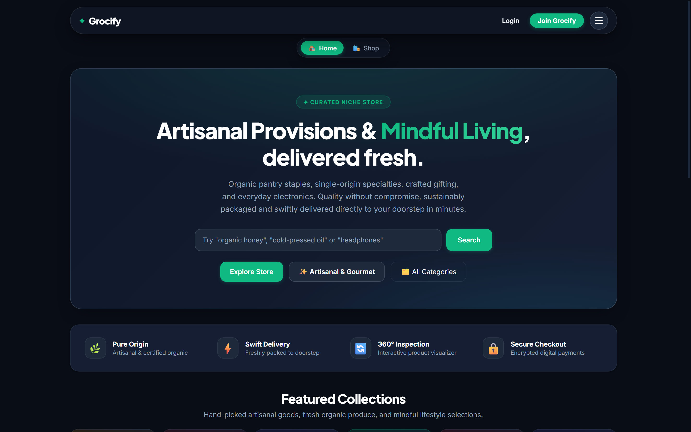
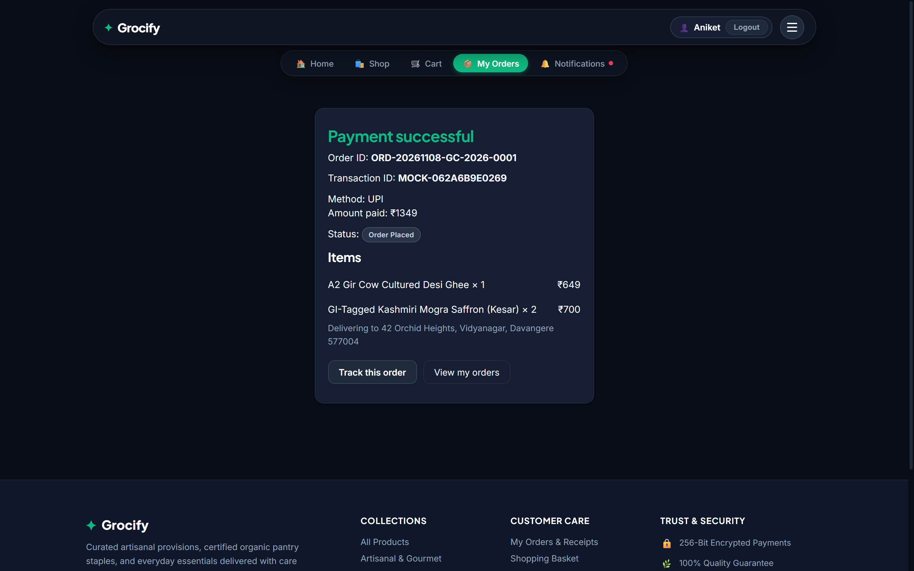
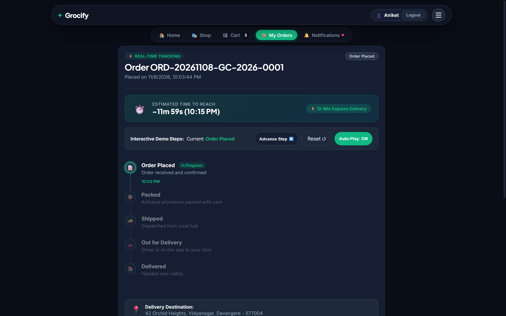
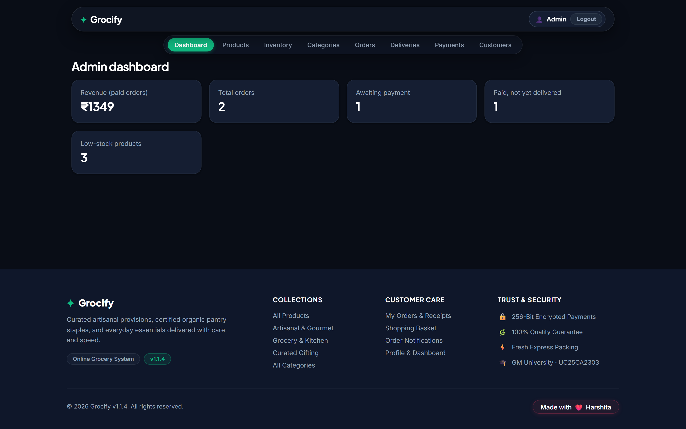
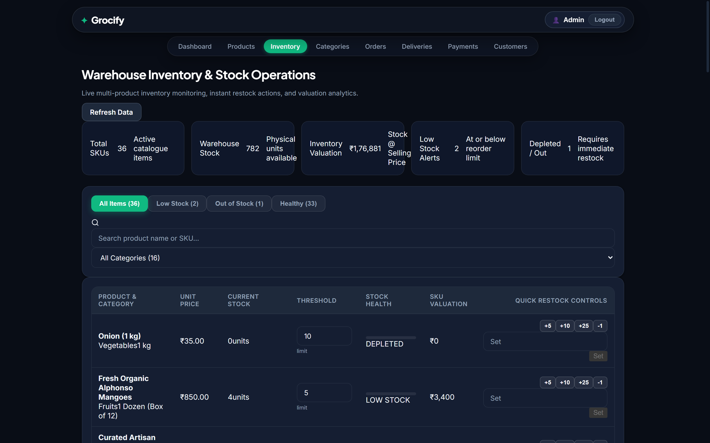
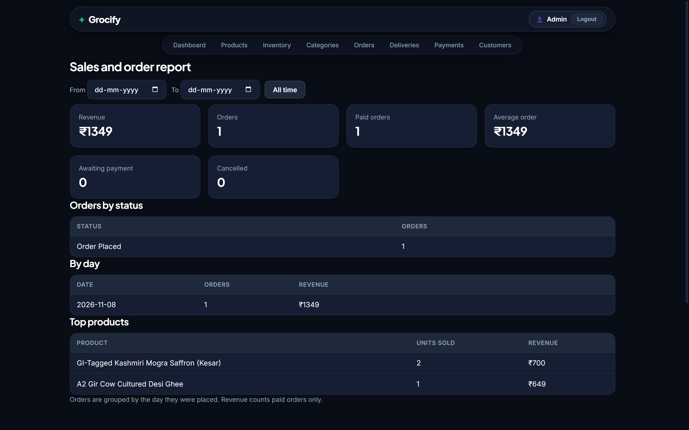
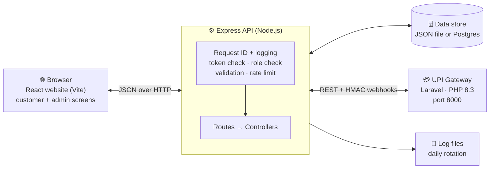
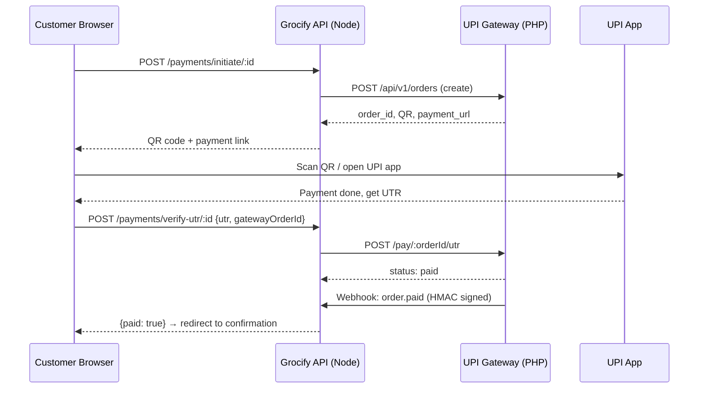
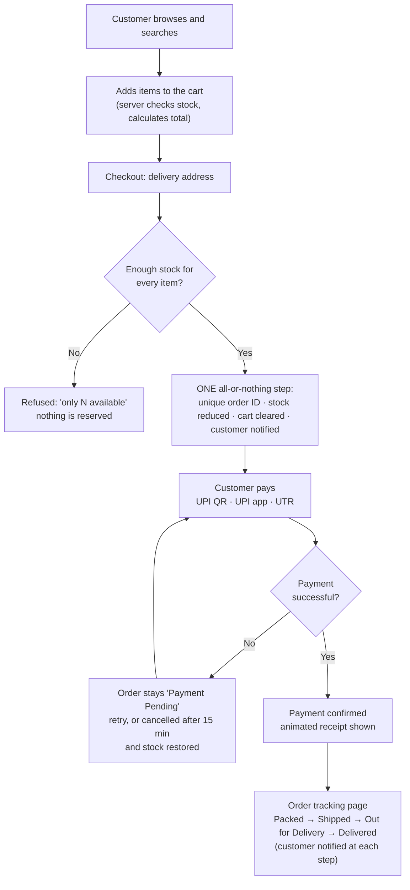
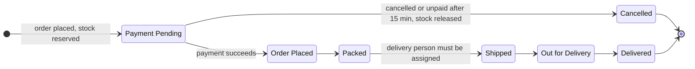

<div align="center">

# 🛒 Grocify

### Online Grocery E-Commerce System with Secure Digital Payments and Logistics Management

Browse, cart, order, pay and track groceries online, with a full admin console behind it.

[](#-versioning)
[](#-testing)
[](https://nodejs.org)
[](https://react.dev)
[](https://expressjs.com)
[](https://vite.dev)
[](#-tech-stack)
[](#-known-limitations)

[Features](#-features) · [Screenshots](#-screenshots) · [Tech stack](#-tech-stack) · [Quick start](#-quick-start) · [Project structure](#-project-structure) · [Workflow](#-workflow) · [API](#-api-reference) · [Testing](#-testing) · [Docs](#-documentation)

</div>

---

## 📑 Table of contents

- [About](#-about)
- [Features](#-features)
- [Screenshots](#-screenshots)
- [Tech stack](#-tech-stack)
- [Architecture](#-architecture)
- [Quick start](#-quick-start)
- [Configuration](#-configuration)
- [Scripts](#-scripts)
- [Project structure](#-project-structure)
- [Workflow](#-workflow)
- [API reference](#-api-reference)
- [Roles and permissions](#-roles-and-permissions)
- [Security](#-security)
- [Logging](#-logging)
- [Testing](#-testing)
- [Known limitations](#-known-limitations)
- [Roadmap](#-roadmap)
- [Documentation](#-documentation)
- [Versioning](#-versioning)
- [License](#-license)

---

## 🌱 About

Grocify is a working online grocery store built as a college **Project Based Learning (PBL)** assignment for the course *E-Commerce and Digital Business* (UC25CA2303, GM University).

Customers can search groceries, fill a cart, place an order, pay with real UPI (or mock mode), and follow the order through five delivery stages until it arrives. Administrators manage products, categories, customers, orders, payments, stock and deliveries from one place, and read sales reports.

Beyond the basic shopping flow, the design focuses on what makes real shops fail: two customers buying the last item at the same moment, a double-clicked pay button, stock held by orders nobody pays for, and card details ending up in the wrong place.

> **Status:** all required functions work and are covered by automated tests. The project supports both a **self-hosted UPI payment gateway** (real QR codes, UTR verification) and a **mock payment provider** (no real money). See [Known limitations](#-known-limitations).

## ✨ Features

<table>
<tr>
<td width="50%" valign="top">

### 👤 Customer
- Register, log in, edit profile and delivery address
- Browse by category, search, see price / description / availability
- Cart: add, change quantity, remove, automatic total
- Place an order with a delivery address and a unique order ID
- **UPI payments** via self-hosted gateway: scan QR, pay with any UPI app, or submit a 12-digit UTR for instant verification (~1.7s)
- Card and net banking placeholders (coming soon)
- **Animated payment confirmation** with receipt card, order details and item breakdown
- **Order tracking** with five delivery stages, ETA countdown, driver card and demo auto-play
- In-app **notifications** for order, payment and delivery updates
- **PWA support**: installable on mobile with service worker

</td>
<td width="50%" valign="top">

### 🛠️ Admin
- Dashboard with revenue, orders and low-stock counts
- Add, edit and delete products and categories (with e-commerce fields: weight, origin, images)
- View and manage orders, customers and payments
- **Inventory** view with low-stock highlighting and instant restock
- **Assign delivery** and move orders through five delivery steps
- **Sales and order reports** with a date range
- UPI Gateway admin panel for order management and merchant settings

</td>
</tr>
<tr>
<td colspan="2">

### ⚙️ Built-in dependability
- **All-or-nothing order creation:** stock check, stock reduction, order write and cart clear happen as one step
- **Unique order IDs** per customer (`ORD-20261109-AB12-0001`), safe under concurrent orders
- **Double-click safe checkout** using a one-time idempotency key
- **Automatic stock release** when an order is unpaid after 15 minutes or cancelled
- **No card or UPI details ever stored**; payment goes through a swappable provider layer
- **HMAC-SHA256 signed webhooks** between the UPI gateway and Grocify for tamper-proof payment confirmation
- **Request-ID logging** with daily rotating files

</td>
</tr>
</table>

## 📸 Screenshots

<table>
<tr>
<td align="center"><br><sub><b>Storefront:</b> curated hero & collection navigation</sub></td>
<td align="center"><br><sub><b>Products:</b> category filter, search, badges & Indian grocery photography</sub></td>
</tr>
<tr>
<td align="center"><br><sub><b>Cart:</b> quantity controls, instant subtotals and checkout</sub></td>
<td align="center"><br><sub><b>Payment:</b> UPI QR code, app deep-link, UTR verification</sub></td>
</tr>
<tr>
<td align="center"><br><sub><b>Confirmation:</b> animated checkmark, receipt card & order details</sub></td>
<td align="center"><br><sub><b>Tracking:</b> five-step delivery timeline with ETA & driver card</sub></td>
</tr>
<tr>
<td align="center"><br><sub><b>Dashboard:</b> revenue, order count & low-stock alerts</sub></td>
<td align="center"><br><sub><b>Inventory:</b> SKU monitoring & instant restock</sub></td>
</tr>
<tr>
<td align="center"><br><sub><b>Logistics:</b> order assignment and step advancement</sub></td>
<td align="center"><br><sub><b>Analytics:</b> revenue, order breakdown & top-selling items</sub></td>
</tr>
</table>

More screens are in [`docs/screenshots`](docs/screenshots). A clickable design mock-up is in [`docs/mockup.html`](docs/mockup.html).

## 🧰 Tech stack

### Languages

| Language | Where it is used |
|---|---|
| **JavaScript** (ES modules, Node.js) | Backend: server, data store, payments, middleware, scripts |
| **JavaScript + JSX** (React) | Frontend: screens, components, state |
| **CSS3** | Frontend styling (hand-written, no framework) |
| **HTML5** | App shell (`index.html`) and the design mock-up |
| **PHP 8.3** (Laravel 12) | Self-hosted UPI payment gateway (`upi-gateway/`) |
| **JavaScript** | Automated tests (`node:test`) |
| **Python 3** | Documentation tooling only: draws diagrams, builds the Word report |
| **Markdown** | Documentation |

### Frontend

| Technology | Version | Purpose |
|---|---|---|
| [React](https://react.dev) | 19 | User interface |
| [React Router](https://reactrouter.com) | 7 | Pages and navigation |
| [Vite](https://vite.dev) | 8 | Dev server and build |
| [@vitejs/plugin-react](https://github.com/vitejs/vite-plugin-react) | 6 | React support for Vite |
| JavaScript, JSX, CSS3, HTML5 | n/a | Languages (no TypeScript, no CSS framework) |

### Backend

| Technology | Version | Purpose |
|---|---|---|
| [Node.js](https://nodejs.org) | >= 22.12 | Runtime |
| [Express](https://expressjs.com) | 5 | Web framework and routing |
| [bcryptjs](https://github.com/dcodeIO/bcrypt.js) | 3 | Password hashing |
| [jsonwebtoken](https://github.com/auth0/node-jsonwebtoken) | 9 | Signed login tokens |
| [helmet](https://helmetjs.github.io) | 8 | Security headers |
| [cors](https://github.com/expressjs/cors) | 2 | Allowed website address |
| [express-rate-limit](https://github.com/express-rate-limit/express-rate-limit) | 8 | Login attempt limiting |
| [dotenv](https://github.com/motdotla/dotenv) | 18 | Settings from `.env` |
| [Winston](https://github.com/winstonjs/winston) | 3 | Logging |

### UPI Payment Gateway

| Technology | Version | Purpose |
|---|---|---|
| [PHP](https://www.php.net) | 8.3 | Runtime |
| [Laravel](https://laravel.com) | 12 | Framework |
| SQLite | — | Gateway database (orders, merchants, webhooks) |
| HMAC-SHA256 | — | Webhook signing and verification |

### Data, payments and tooling

| Area | Today | Planned |
|---|---|---|
| **Data store** | Local JSON file (`server/data/localStore.js`) | Firebase Firestore (same function names) |
| **Postgres** (optional) | `DATABASE_URL` env var for persistent data across deploys | — |
| **Login** | bcrypt + signed tokens (HS256, 7 days) | Firebase Authentication |
| **Payments** | Self-hosted UPI gateway (`upi-gateway/`) or mock provider | — |
| **Testing** | Node's built-in test runner (`node:test`) | — |
| **Docs tooling** | Python 3 with `python-docx` and `matplotlib` | — |
| **Version control** | Git and GitHub, pull-request workflow | — |

## 🏗️ Architecture

The website never touches data directly. Every action goes through the server, which checks **who** is asking (token), **what they may do** (role) and **whether the input is valid** before reading or changing anything.



### Payment flow



Design diagrams (ER diagram, order flow) are in the [project report](docs/Grocify-Project-Report.docx) and [`docs/diagrams`](docs/diagrams).

## 🚀 Quick start

### Prerequisites

- **Node.js 22.12 or newer** (check with `node -v`) and **npm**
- **Git**
- **PHP 8.3+** (only if using the UPI gateway; check with `php -v`)

### Run it

```bash
# 1. Get the code
git clone https://github.com/Aniket886/Grocify.git
cd Grocify

# 2. Install dependencies
npm install

# 3. Create your settings file, then open .env and set SEED_ADMIN_EMAIL and SEED_ADMIN_PASSWORD
cp .env.example .env

# 4. Create sample products and the admin account
npm run seed

# 5. Start the server (terminal 1)
npm run server

# 6. Start the website (terminal 2)
npm run dev:client
```

Then open **http://localhost:5173**. The API runs on port 5000.

> On Windows, use Git Bash or PowerShell; the commands are the same (use `Copy-Item .env.example .env` instead of `cp` in PowerShell).

**Log in as admin** with the email and password you put in `.env`. **Customers** register from the website.

### One-command start (Windows)

```bash
start-grocify.bat
```

Starts the API (port 5000), website (port 5173) and UPI gateway (port 8000) together.

### Mock mode vs UPI Gateway

| | Mock mode | UPI Gateway |
|---|---|---|
| **Setup** | Default, no extra config | Set `PAYMENT_PROVIDER=gateway` in `.env` + gateway credentials |
| **How it works** | "Pay" button succeeds instantly | Real UPI QR codes, UTR verification, webhook confirmation |
| **Real money** | No | No (demo mode: any 12-digit UTR is accepted) |
| **Use for** | Quick demos, testing | Realistic e-commerce demo, PBL presentations |

**Start clean before a demo:** `npm run demo:reset` wipes all data and recreates the samples.

### Setting up the UPI Gateway

```bash
# 1. Install PHP dependencies (one time)
cd upi-gateway
composer install
cp .env.example .env
php artisan key:generate
php artisan migrate

# 2. Set GATEWAY_DEMO_AUTO_APPROVE_UTR=true in upi-gateway/.env for demo mode

# 3. Start the gateway
php artisan serve --host=127.0.0.1 --port=8000

# 4. In the main Grocify .env, set:
#    PAYMENT_PROVIDER=gateway
#    PAYMENT_GATEWAY_URL=http://127.0.0.1:8000
#    PAYMENT_GATEWAY_KEY_ID=<from gateway admin panel>
#    PAYMENT_GATEWAY_SECRET=<from gateway admin panel>
#    PAYMENT_WEBHOOK_SECRET=<from gateway admin panel>
```

The receiving UPI ID is set in the gateway admin panel (`/login`), never in code.

## 🔧 Configuration

Copy `.env.example` to `.env`. `.env` is git-ignored and must never be committed.

| Variable | Default | Purpose |
|---|---|---|
| `NODE_ENV` | `development` | `production` switches off test-only payment shortcuts |
| `PORT` | `5000` | API port |
| `CLIENT_URL` | `http://localhost:5173` | Website address allowed to call the API |
| `JWT_SECRET` | random per start | Signs login tokens. **Set a long random value**, or logins reset on every restart |
| `JWT_EXPIRES_IN` | `7d` | Login lifetime |
| `SEED_ADMIN_EMAIL` / `SEED_ADMIN_PASSWORD` | none | Admin account created by `npm run seed` |
| `PAYMENT_PROVIDER` | `mock` | Payment provider: `mock` (instant) or `gateway` (UPI gateway) |
| `PAYMENT_GATEWAY_URL` | none | UPI gateway address (e.g. `http://127.0.0.1:8000`) |
| `PAYMENT_GATEWAY_KEY_ID` / `SECRET` | none | Gateway API credentials (from the gateway admin panel) |
| `PAYMENT_WEBHOOK_SECRET` | none | HMAC secret for webhook signature verification |
| `PAYMENT_TIMEOUT_MINUTES` | `15` | Unpaid orders are cancelled after this, and stock is released |
| `LOW_STOCK_DEFAULT_LIMIT` | `10` | Low-stock limit for new products |
| `LOG_LEVEL` / `LOG_DIR` | `info` / `./logs` | Logging level and folder |
| `LOG_MAX_FILES` / `LOG_MAX_SIZE` | `14d` / `10m` | Log rotation |
| `DATA_FILE` | `server/data/dev-db.json` | Where the local data file lives (optional). Not tracked by Git |
| `DATABASE_URL` | (empty) | Postgres connection string. When set, data survives every redeploy |

## 📜 Scripts

| Command | What it does |
|---|---|
| `npm run server` | Start the API (port 5000) |
| `npm run dev:server` | Start the API and restart on file changes |
| `npm run dev:client` | Start the website (port 5173, proxies `/api` to the server) |
| `npm run gateway` | Start the UPI gateway (port 8000, needs PHP 8.3+) |
| `npm run build` | Build the website into `dist/` |
| `npm run seed` | Create sample products and the admin account |
| `npm run demo:reset` | Wipe all local data, then seed again (refuses in production) |
| `npm test` | Run all 45 automated tests |

## 🗂️ Project structure

```text
Grocify/
├── index.html                  # App shell loaded by Vite
├── vite.config.js              # Vite setup: React plugin, /api proxy, app version
├── package.json                # Scripts, dependencies, and the app VERSION (single source)
├── .env.example                # Settings template (blank values); copy to .env
├── start-grocify.bat           # One-click launcher: API + site + gateway (Windows)
│
├── server/                     # ── BACKEND (Node.js + Express, JavaScript ES modules)
│   ├── index.js                #   Starts the API and the 1-minute expiry sweep
│   ├── app.js                  #   Builds the app: request ID, security, logging, routes
│   ├── seed.js                 #   Sample products + admin account
│   ├── resetDemo.js            #   Wipe data and re-seed (npm run demo:reset)
│   ├── config/
│   │   ├── env.js              #   Reads .env, app version, defaults
│   │   └── logger.js           #   Winston: levels, JSON lines, daily rotation
│   ├── middleware/
│   │   ├── authenticate.js     #   Verifies the login token
│   │   ├── authorize.js        #   Role check (customer / admin)
│   │   ├── validate.js         #   Input validators
│   │   ├── rateLimit.js        #   Login attempt limiter
│   │   └── errorHandler.js     #   404 and error responses (with request ID)
│   ├── routes/                 #   URL → controller maps (auth, products, categories, cart,
│   │                           #     orders, payments, inventory, notifications, admin)
│   ├── controllers/            #   Request handling and business rules (one per area)
│   │   └── paymentsController.js  # Initiate, verify UTR, status, webhook handler
│   ├── services/
│   │   └── orderService.js     #   Expires unpaid orders and logs each one
│   ├── payments/
│   │   ├── PaymentProvider.js  #   The interface every provider follows
│   │   ├── mockProvider.js     #   Instant success/failure for testing
│   │   ├── gatewayProvider.js  #   Calls the UPI gateway REST API
│   │   └── index.js            #   Picks the provider from PAYMENT_PROVIDER
│   ├── data/
│   │   └── localStore.js       #   Local data store + all-or-nothing order logic
│   └── utils/constants.js      #   Delivery steps and notification types
│
├── src/                        # ── FRONTEND (React + Vite, JavaScript/JSX + CSS)
│   ├── main.jsx                #   Entry point
│   ├── App.jsx                 #   Providers, navbar, routes, footer
│   ├── routes/                 #   AppRoutes, ProtectedRoute (login), AdminRoute (admin)
│   ├── context/                #   AuthContext (login state), CartContext (cart state)
│   ├── services/api.js         #   fetch wrapper that adds the login token
│   ├── components/             #   Navbar, Footer, ProductCard, StatusBadge,
│   │                           #     DeliveryTimeline, ErrorBoundary
│   ├── pages/
│   │   ├── customer/           #   Home, Login, Register, Profile, ProductList,
│   │   │                       #     ProductDetail, Cart, Checkout, Payment,
│   │   │                       #     PaymentConfirmation, OrderHistory, OrderTracking,
│   │   │                       #     Notifications, NotFound
│   │   └── admin/              #   Dashboard, ManageProducts, ManageCategories,
│   │                           #     ManageCustomers, ManageOrders, ManagePayments,
│   │                           #     Inventory, Deliveries, Reports
│   └── styles/main.css         #   All styling
│
├── upi-gateway/                # ── UPI PAYMENT GATEWAY (Laravel 12, PHP 8.3, SQLite)
│   ├── app/
│   │   ├── Http/Controllers/   #   Checkout (QR, UTR), API (orders, merchants), Admin
│   │   ├── Services/           #   OrderService, WebhookOutboxService, WebhookOutboxDispatcher
│   │   ├── Jobs/SendWebhook.php#   Queued HMAC-signed webhook delivery with retries
│   │   └── Models/             #   Order, User (merchant), WebhookOutbox
│   ├── database/               #   Migrations and SQLite database (git-ignored)
│   ├── routes/                 #   Web and API routes
│   └── .env                    #   Gateway config (git-ignored)
│
├── tests/                      # ── 45 automated tests (node:test)
│   ├── api.test.js             #   Login, roles, products, cart
│   ├── orders.test.js          #   Orders, IDs, payment, inventory, concurrency
│   ├── delivery.test.js        #   Delivery steps, notifications, admin views, reports
│   └── hardening.test.js       #   Bad input, security, stress, logging safety, version
│
├── docs/                       # ── DOCUMENTATION
│   ├── Grocify-Project-Report.docx   # The PBL project report (Word)
│   ├── Demo-Script.md          #   Demo steps and viva preparation
│   ├── Test-Report.md          #   Every test, by requirement
│   ├── Logging.md              #   What is logged, with a real sample
│   ├── Phase2-Design.md        #   Use cases, ER diagram, flows, data model
│   ├── mockup.html             #   Clickable design mock-up
│   ├── diagrams/               #   Diagram images + make_diagrams.py
│   ├── screenshots/            #   App screenshots used in the report and this README
│   └── report/build_report.py  #   Rebuilds the Word report (Python)
│
├── logs/                       # Runtime logs (git-ignored)
└── public/images/              # Product images (optimised 800px)
```

<sub>Not tracked by Git: `node_modules/`, `dist/`, `.env`, `logs/*.log`, `server/data/dev-db.json`, and `upi-gateway/.env`, `upi-gateway/database/*.sqlite`.</sub>

## 🔄 Workflow

### 1. How an order moves through the system



### 2. Order status lifecycle



Delivery moves **one step at a time**: no skipping and no going back.

### 3. Development workflow

The project was built in phases that fit the 14-week PBL timeline. Each phase ended with something that could be run and checked.

| Phase | Work | Delivered through |
|---|---|---|
| 1 Plan | Problem, roles, tools, project set-up | First push to `main` |
| 2 Design | Use cases, data model, flows, clickable mock-up | First push to `main` |
| 3 Core shopping | Login, products, cart, admin product management | First push to `main` |
| 4 Orders and payment | Orders, mock payment, stock updates | First push to `main` |
| 5 Delivery and admin | Delivery tracking, notifications, reports | [PR #1](https://github.com/Aniket886/Grocify/pull/1) |
| 6 Hardening | Logging fixes, 13 hardening tests, UI polish, test report | [PR #2](https://github.com/Aniket886/Grocify/pull/2) |
| 7 Final | Project report, demo script, demo reset command | [PR #3](https://github.com/Aniket886/Grocify/pull/3) |
| v1.0.0 | README refresh, version in footer and API | [PR #4](https://github.com/Aniket886/Grocify/pull/4) |
| UI overhaul | Dark theme, responsive landing page, modern UI | [PR #5](https://github.com/Aniket886/Grocify/pull/5) – [PR #6](https://github.com/Aniket886/Grocify/pull/6) |
| PWA + auth fixes | Mobile install banner, service worker, auto-seed login | — |
| Product catalogue | Real Indian grocery photography, optimised images, e-commerce fields | [PR #7](https://github.com/Aniket886/Grocify/pull/7) – [PR #8](https://github.com/Aniket886/Grocify/pull/8) |
| UPI Gateway | Self-hosted Laravel gateway, QR payments, webhook flow | [PR #9](https://github.com/Aniket886/Grocify/pull/9) |
| Rs. 1 test product | Tea sachet priced at Rs. 1 for end-to-end UPI testing | [PR #10](https://github.com/Aniket886/Grocify/pull/10) |
| Demo mode banner | Clear "no real money" notice when using mock payments | [PR #11](https://github.com/Aniket886/Grocify/pull/11) |
| Data persistence | Postgres support for surviving Render redeploys | [PR #12](https://github.com/Aniket886/Grocify/pull/12) |
| Payment placeholders | Card and net banking placeholder panels, clearer UPI wording | [PR #13](https://github.com/Aniket886/Grocify/pull/13) |
| Gateway demo mode | `GATEWAY_DEMO_AUTO_APPROVE_UTR` switch for demos | [PR #14](https://github.com/Aniket886/Grocify/pull/14) |
| Payment UI redesign | Professional checkout page with QR, timer, UPI app buttons | [PR #15](https://github.com/Aniket886/Grocify/pull/15) |
| Fast UTR + order flow | UTR verification 13s → 1.7s, confirmation + tracking redesign | [PR #16](https://github.com/Aniket886/Grocify/pull/16) |

### 4. Git work tree

`main` is the stable branch. After the first push, **every change goes on its own branch and is merged through a reviewed pull request**. Nothing is pushed straight to `main`.

**Branch names** describe the work (`feat/fast-utr-and-order-flow`). **Commits** are grouped by purpose with a clear title and a body explaining what changed and why. **Pull requests** have a clear title, a summary, how it was tested, and notes for the reviewer.

```bash
git checkout main && git pull
git checkout -b my-change          # 1. branch from an up-to-date main
# ...edit...
npm test                           # 2. all tests must pass
git add -A && git commit           # 3. meaningful commit message
git push -u origin my-change       # 4. push the branch
gh pr create --base main           # 5. open a PR, review, then merge on GitHub
```

## 🔌 API reference

Base address: `http://localhost:5000/api`. Everything is JSON. 🔓 public · 🔑 any logged-in user · 👤 customer · 🛡️ admin.

| Method | Path | Access | What it does |
|---|---|---|---|
| GET | `/health` | 🔓 | Server status and app version |
| POST | `/auth/register` | 🔓 | Create a customer account (rate-limited) |
| POST | `/auth/login` | 🔓 | Log in, receive a token (rate-limited) |
| GET | `/auth/me` | 🔑 | Current user |
| PUT | `/auth/profile` | 🔑 | Update name, phone and delivery address |
| GET | `/categories` | 🔓 | List categories |
| POST · PUT · DELETE | `/categories`, `/categories/:id` | 🛡️ | Add, rename, delete a category |
| GET | `/products` | 🔓 | List products (`?category=`, `?q=`) |
| GET | `/products/:id` | 🔓 | One product |
| POST · PUT · DELETE | `/products`, `/products/:id` | 🛡️ | Add, edit, delete (hide) a product |
| GET | `/cart` | 👤 | Current cart with total |
| POST | `/cart/items` | 👤 | Add an item |
| PATCH · DELETE | `/cart/items/:productId` | 👤 | Set quantity, remove |
| POST | `/orders` | 👤 | Place an order (header `Idempotency-Key`) |
| GET | `/orders` | 👤 | My order history |
| GET | `/orders/:id` | 👤 owner · 🛡️ | One order with payment and delivery |
| POST | `/orders/:id/pay` | 👤 owner | Pay (mock mode only) |
| POST | `/orders/:id/cancel` | 👤 owner · 🛡️ | Cancel an unpaid order |
| POST | `/orders/:id/progress` | 👤 owner | Advance demo delivery step |
| GET | `/payments/config` | 🔓 | Active provider and whether test mode is on |
| POST | `/payments/initiate/:id` | 👤 owner | Create a UPI gateway payment order |
| GET | `/payments/status/:id` | 👤 owner | Check payment status (`?local=1` for local-only) |
| POST | `/payments/verify-utr/:id` | 👤 owner | Submit UTR for instant verification |
| POST | `/payments/webhook` | 🔓 | Receive HMAC-signed gateway webhook |
| GET | `/notifications` | 👤 | My notifications and unread count |
| POST | `/notifications/read-all` · `/:id/read` | 👤 | Mark read |
| GET | `/inventory` | 🛡️ | Stock list (`?lowOnly=true`) |
| GET | `/admin/orders` · `/admin/orders/:id` | 🛡️ | All orders (`?status=`), one order |
| GET | `/admin/deliveries` | 🛡️ | Paid orders with delivery details |
| POST | `/admin/orders/:id/assign` | 🛡️ | Assign a delivery person |
| PATCH | `/admin/orders/:id/status` | 🛡️ | Move to the next delivery step |
| GET | `/admin/customers` · `/admin/payments` | 🛡️ | Customers (with totals), payments |
| GET | `/admin/reports/sales` | 🛡️ | Sales report (`?from=&to=`) |

## 🔐 Roles and permissions

| Action | Guest | Customer | Admin |
|---|:---:|:---:|:---:|
| Browse and search products | ✅ | ✅ | ✅ |
| Register and log in | ✅ | n/a | n/a |
| Cart, checkout, pay, track, notifications | ❌ | ✅ (own) | ❌ |
| View any order, customer or payment | ❌ | ❌ | ✅ |
| Manage products and categories | ❌ | ❌ | ✅ |
| Inventory, deliveries, reports | ❌ | ❌ | ✅ |

Roles are enforced **on the server** for every request. Nobody can register as an admin.

## 🛡️ Security

- Passwords stored only as **bcrypt hashes**; login errors never reveal whether the email or password was wrong.
- **Signed tokens** (HS256, 7 days) verified on every protected request; roles are looked up fresh each time.
- **Server-side validation** of all input; oversized or broken requests are refused with a clear message, never a crash.
- **Rate limiting** on login and register (30 attempts per 15 minutes), **security headers** (Helmet), **CORS** limited to the website address, 100 KB request limit.
- **Card, UPI and bank details are never accepted or stored.** Only method, status and transaction ID are kept.
- **HMAC-SHA256 signed webhooks** between the UPI gateway and Grocify, with timestamp validation and replay protection.
- Responses never contain password hashes; logs never contain passwords, tokens, card data or request bodies (an automated test scans for this).
- `.env` is git-ignored; `.env.example` holds blanks only.

## 📝 Logging

[Winston](https://github.com/winstonjs/winston) writes JSON lines to `logs/app-YYYY-MM-DD.log` and `logs/error-YYYY-MM-DD.log` (14 days kept, 10 MB per file). Every request has an **ID** (response header `X-Request-Id`) that appears on every log line it produces, so one action can be followed from the screen to the log. Details and a real sample: [`docs/Logging.md`](docs/Logging.md).

## 🧪 Testing

```bash
npm test
```

**45 automated tests** start the real server on a temporary data file, so they never touch your demo data.

| File | Tests | Covers |
|---|:---:|---|
| `tests/api.test.js` | 10 | Login, roles, products, cart |
| `tests/orders.test.js` | 11 | Order IDs, idempotency, payment retry, inventory, cancel/expiry, order privacy |
| `tests/delivery.test.js` | 10 | Delivery step rules, notifications, admin views, sales report |
| `tests/hardening.test.js` | 14 | Bad input, token forgery, no secrets in responses or logs, stress, version |

Highlights: **20 customers race for 5 units and exactly 5 orders succeed with stock ending at 0**; 10 simultaneous checkouts with one key create one order; two simultaneous payments record one success. Full list: [`docs/Test-Report.md`](docs/Test-Report.md).

## ⚠️ Known limitations

- **Local mode:** data lives in a local JSON file by default (Postgres is optional). Fine for one server; Firebase is the planned replacement.
- **UPI gateway is single-threaded:** `php artisan serve` handles one request at a time. Fine for demos; production would use Nginx + PHP-FPM.
- **Demo UTR mode:** with `GATEWAY_DEMO_AUTO_APPROVE_UTR=true`, any 12-digit number is accepted. Real bank-credit verification requires forwarding SMS alerts to the gateway.
- **Notifications** appear inside the website only (no email or SMS).
- **Card and net banking** are placeholder panels — only UPI payments work today.
- Browser checks were done by hand; the server logic is covered by automated tests.

## 🗺️ Roadmap

- [ ] Connect Firebase (login and database)
- [ ] Card and net banking payment methods
- [ ] Email / SMS / messaging-app notifications
- [ ] Delivery partner screen and live status updates; PDF invoices
- [ ] Product photos, coupons, delivery time slots
- [ ] Nginx + PHP-FPM for production gateway deployment
- [ ] Automated browser tests and a CI pipeline

## 📚 Documentation

| Document | What it is |
|---|---|
| [Project report (Word)](docs/Grocify-Project-Report.docx) | The PBL report with design, implementation and results |
| [Demo script and viva prep](docs/Demo-Script.md) | Step-by-step demo, troubleshooting, viva questions |
| [Test report](docs/Test-Report.md) | Every test, grouped by requirement |
| [Logging](docs/Logging.md) | What is logged, with a real sample |
| [Design](docs/Phase2-Design.md) | Use cases, ER diagram, flows, data model |
| [Mock-up](docs/mockup.html) | Clickable design prototype (open in a browser) |

## 🏷️ Versioning

Grocify follows [Semantic Versioning](https://semver.org). The version lives in **one place**, `package.json`, and is shown in the website footer and in `GET /api/health`.

To release a new version:

```bash
npm version minor --no-git-tag-version   # or patch / major; updates package.json and the lockfile
# then update the version badge at the top of this README
```

## 📄 License

This is an academic project for GM University (course UC25CA2303). No open-source license has been chosen yet, so all rights are reserved by default.

---

<div align="center">

**Grocify v1.1.4** · Online Grocery E-Commerce System · UC25CA2303 · GM University

<sub>README last updated 2026-11-09 · [Report an issue](https://github.com/Aniket886/Grocify/issues)</sub>

</div>
