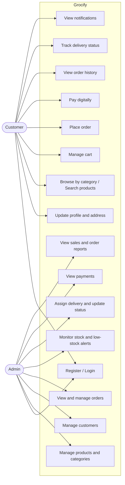
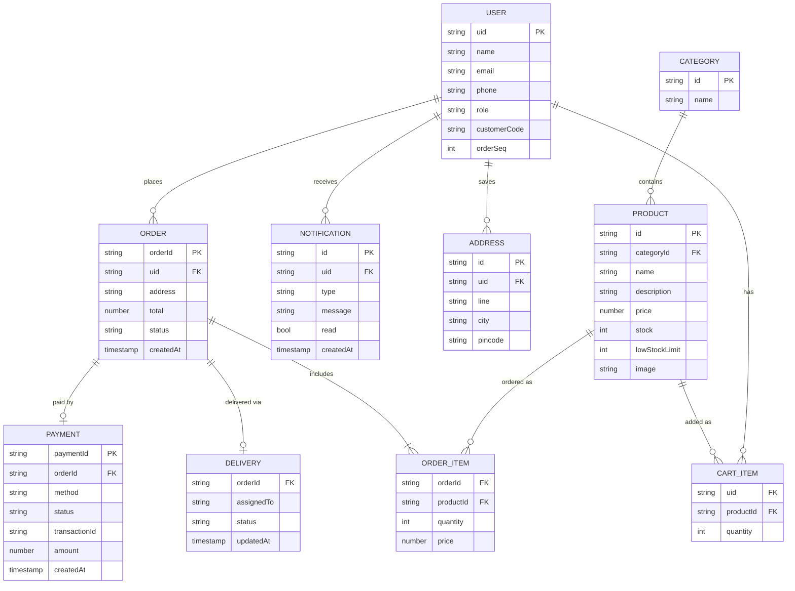
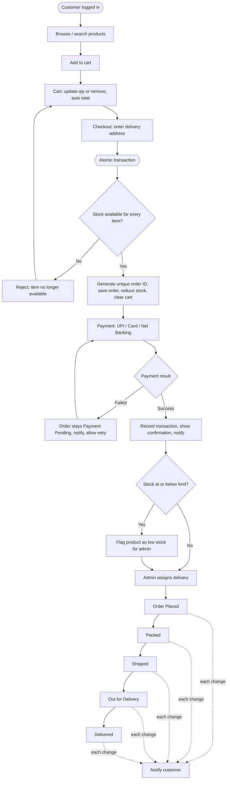

# Grocify: Phase 2 Design (Weeks 5–6)

Diagrams use Mermaid (they render in GitHub and VS Code preview). Copy them into the report as images.

## 1. Use-Case Diagram

## 2. ER Diagram

## 3. Order Flow Chart

> Stock is reduced when the order is created (inside the transaction), and a failed payment can be retried, so a decision is needed: if a payment is never completed, stock is released after a timeout. Confirm this rule with your team before Phase 4.

## 4. Database Collections (Firestore)

| Collection | Document ID | Fields | Notes |
|---|---|---|---|
| `users` | Firebase UID | name, email, phone, role (`customer`/`admin`), customerCode, orderSeq, createdAt | Role is set only by the server; never by the client |
| `users/{uid}/addresses` | auto | line, city, pincode, isDefault | |
| `users/{uid}/cart` | productId | quantity | One doc per product in the cart |
| `categories` | auto | name | |
| `products` | auto | categoryId, name, description, price, stock, lowStockLimit, image, isActive | `isActive` supports "delete" without breaking old orders |
| `orders` | orderId | uid, items[ {productId, name, price, quantity} ], address, total, status, createdAt | Item names and prices are copied so later price changes do not alter old orders |
| `payments` | paymentId | orderId, uid, method, status, transactionId, amount, createdAt | No card or UPI PIN data stored |
| `deliveries` | orderId | assignedTo, status, history[ {status, at} ], updatedAt | |
| `notifications` | auto | uid, type, message, read, createdAt | |

**Indexes needed:** orders by (`uid`, `createdAt`); products by (`categoryId`); products by stock vs `lowStockLimit` (computed on write as a `isLowStock` flag).

**Access rules (summary for `firestore.rules`):**
- Customers: read products and categories; read and write only their own `users`, cart and addresses; read only their own orders, payments, deliveries and notifications; cannot write orders, payments or stock directly (the server does).
- Admin: read all; writes go through the server's admin routes.

## 5. Order ID and Concurrency Design

- **Format:** `ORD-YYYYMMDD-<customerCode>-<seq>`, e.g. `ORD-20261105-AK7Q-0003`.
- `customerCode` is a short random code created at registration. `seq` is `users/{uid}.orderSeq`, incremented in the same transaction that writes the order.
- **Transaction steps:** read user (seq) → read each product (stock) → verify stock ≥ quantity → decrement stock and set `isLowStock` → write the order with the new ID → increment `orderSeq` → delete the cart items.
- **Two users, same item:** the database retries the loser, which then sees the new stock and fails cleanly. Nothing is half-written.
- **Same user, double-click:** the client sends an idempotency key with the request; the server ignores a repeated key.
- **Payment webhook or callback:** processed once per `transactionId`.
- **Test for Phase 6:** two customers order the last unit at the same moment; exactly one succeeds.

## 6. Delivery Status Rules

`Order Placed → Packed → Shipped → Out for Delivery → Delivered`. Only the next status is allowed; no skipping or going back. Each change adds an entry to `history` and sends a notification.

## 7. Screen Mock-ups

Open `docs/mockup.html` in a browser. It is a clickable prototype with sample data. Nothing is saved, no server is needed. It covers: login, products with category filter and search, cart, checkout, payment, confirmation, order tracking, and the admin dashboard, products, orders and inventory.

## 8. Phase 2 Checklist

- [x] Use-case diagram
- [x] ER diagram
- [x] Order-flow chart
- [x] Database collections and access rules
- [x] Order ID and concurrency design
- [x] Clickable mock-up (`docs/mockup.html`)
- [ ] Firebase project created (needs your Firebase and Google IDs)
- [ ] Team confirms the stock-release rule in section 3
